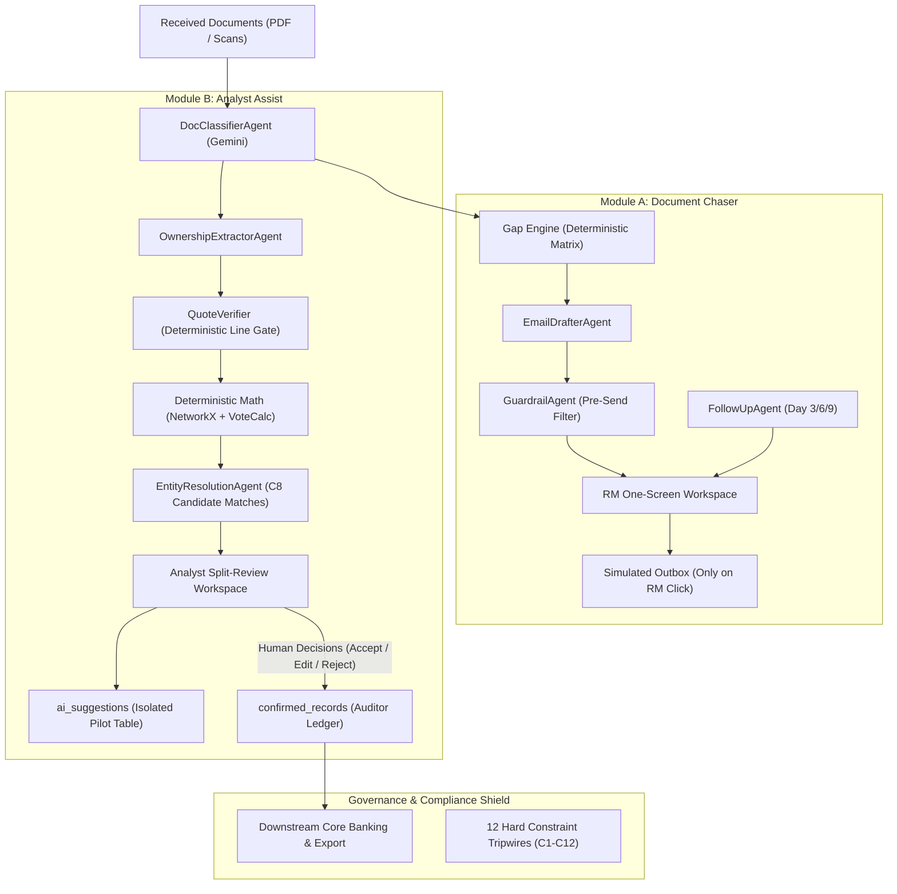
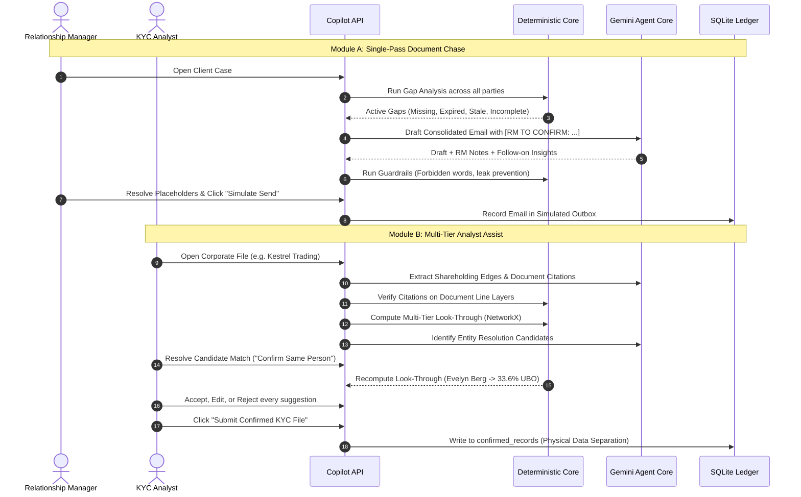

# Northgate KYC Copilot

> **Forward Deployed Engineer (FDE) Demo Platform**  
> Applied AI & Deterministic Automation for High-Stakes Financial KYC Onboarding.  
> *All data is 100% synthetic.*

---

## 1. Executive Summary

Northgate (fictional private bank & commercial firm) takes **62 days** on average to onboard a client. Two major bottlenecks account for 28 of those days:

1. **Module A: Document Chaser (17 of 62 days)**
   - *Problem*: Missing documents are identified one-at-a-time, resulting in 3 separate sequential chase rounds of 5–6 days each.
   - *Solution*: A deterministic rules engine discovers **every gap in a single pass**, drafts **one consolidated email** with pre-send guardrails, and automates **Day 3/6/9 reminder cadence** with a mock business calendar.
2. **Module B: Analyst Assist (11 of 62 days)**
   - *Problem*: KYC analysts spend days reading multi-tier incorporation records to establish look-through beneficial ownership and voting power.
   - *Solution*: AI pre-fills owners, percentages, voting control, and multi-tier look-through, with **verifiable page and line citations**. The human analyst accepts, edits, or rejects every row. **The AI never outputs a risk rating.**

**Core Design Principle**: *"AI prepares, human decides."* Nothing is ever auto-sent. Nothing is ever auto-accepted.

---

## 2. System Architecture



---

## 3. End-to-End Decision Flow



---

## 4. The 12 Hard Non-Negotiable Constraints

| Constraint | Enforcement in Northgate KYC Copilot |
|---|---|
| **C1. Official Google GenAI SDK** | Uses `google-genai` Python SDK with `temperature=0` and Pydantic JSON schemas. |
| **C2. Zero Auto-Send** | Drafts are saved with status `draft`. Simulated outbox writes only after explicit RM click. |
| **C3. Facts Only (No Forgery Judgment)** | Validates observable facts only (dates, completeness, signatures). Never judges authenticity. |
| **C4. Zero Risk Ratings (MLRO Red Line)** | Automated tripwire verifies 0 risk columns exist across the entire database schema and API. |
| **C5. Deterministic Verbatim Citations** | `QuoteVerifier` verifies every citation against pre-indexed text layers before human review. |
| **C6. Deterministic Math** | All percentages, look-through graphs, and voting rights computed via Python & NetworkX. |
| **C7. Strict Field Types** | Strict schema enum: `EXTRACTED`, `COMPUTED`, or `NOT_FOUND`. Never guesses or infers. |
| **C8. Human Entity Resolution** | Candidate matches appear as *"Confirm or Separate?"*. Look-through updates only upon confirmation. |
| **C9. Strict Data Separation** | Downstream consumers read exclusively from `confirmed_records`. `ai_suggestions` is isolated. |
| **C10. Seeded Canaries** | Configurable share (10%) of fields carry planted errors to track analyst vigilance in pilot mode. |
| **C11. 100% Synthetic Data** | Prominent `"SYNTHETIC DEMO DATA"` banner displayed across all views. |
| **C12. Demo Cache Resilience** | `DEMO_MODE=true` falls back instantly to pre-recorded responses in `demo_cache/`. |

---

## 5. Quickstart & Developer Workflow

### Prerequisites
- Python 3.11+ (Python 3.13 recommended)
- Node.js 18+ and npm
- Windows PowerShell, macOS, or Linux

### Installation & Run

```bash
# 1. Setup virtualenv and frontend dependencies
make setup

# 2. Generate synthetic test documents (PDFs & skewed scan) and seed SQLite database
make seed

# 3. Start development servers (FastAPI backend on :8000, Vite React frontend on :3000)
make dev

# 4. Run automated test suite (44 unit & regression tests)
make test

# 5. Run evaluation harness against ground-truth answer keys
make eval

# 6. Record or refresh live Gemini API responses into demo cache
make record-cache
```

---

## 6. Project Directory Structure

```text
northgate-kyc-copilot/
├── README.md                      # Architecture guide & quickstart
├── Makefile                       # Dev targets (setup, seed, dev, test, eval, record-cache)
├── pytest.ini                     # Pytest configuration
├── docs/
│   ├── demo_script.md             # 10-minute guide presentation script
│   ├── architecture.md            # Detailed architecture & constraint matrix
│   ├── agent_specs.md             # Agent schemas, prompts, failure modes
│   └── limitations.md             # Honest list of what is not validated
├── scripts/
│   └── record_demo_cache.py       # Live Gemini API response cache recorder
├── backend/
│   ├── requirements.txt
│   ├── eval/
│   │   ├── run_eval.py            # Evaluation runner against ground-truth keys
│   │   └── eval_report.json       # Generated eval report
│   ├── tests/                     # 44 unit & integration tests
│   └── app/
│       ├── main.py                # FastAPI entrypoint & router registration
│       ├── config.py              # Settings from environment (.env)
│       ├── db.py                  # SQLite engine, sessions, Base
│       ├── models/                # SQLAlchemy models (chase, kyc, governance)
│       ├── schemas/               # Pydantic schemas
│       ├── routers/               # REST endpoints (cases, chase, companies, analyst, metrics, governance, admin)
│       ├── llm/                   # Gemini SDK wrapper, prompts, demo cache
│       ├── agents/                # LLM agent definitions (Classifier, Drafter, Guardrail, etc.)
│       ├── engines/               # Deterministic core (GapEngine, Lookthrough, VoteCalc, QuoteVerifier)
│       ├── services/              # Workflow services (confirm_workflow, canaries)
│       └── seed/                  # Synthetic document generators & answer keys
└── frontend/
    ├── package.json
    ├── vite.config.ts
    ├── tailwind.config.js
    └── src/
        ├── api/                   # Typed API clients
        ├── components/            # UI components (PdfViewer, OwnershipGraph, ConfirmRow, GapTable, etc.)
        ├── pages/                 # Home, Chaser, Analyst, Tasks, Metrics, Governance, Eval
        └── types/                 # TypeScript interfaces
```

---

## 7. Documentation Links
- [10-Minute Guide Presentation Script](file:///c:/Users/v69-labuser449619/Desktop/Document%20Chaser/docs/demo_script.md)
- [System Architecture & Constraint Matrix](file:///c:/Users/v69-labuser449619/Desktop/Document%20Chaser/docs/architecture.md)
- [Agent & Deterministic Engine Specifications](file:///c:/Users/v69-labuser449619/Desktop/Document%20Chaser/docs/agent_specs.md)
- [Technical Limitations & Boundary Scope](file:///c:/Users/v69-labuser449619/Desktop/Document%20Chaser/docs/limitations.md)
